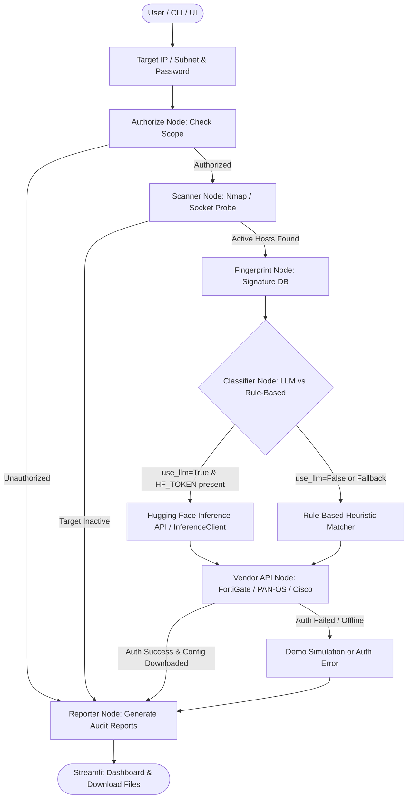

# 🛡️ Firewall File Downloader & Security Audit Agent — System Setup & Architecture

> **Purpose of this document:**  
> This file provides a comprehensive technical overview, operational architecture, environment setup, and implementation guide for this project so that any AI agent, coding assistant, or developer can immediately understand, maintain, and extend the system.

---

## 📌 Executive Summary

The **Firewall File Downloader & Security Audit Agent** is an automated network security auditing framework designed to:
1. **Probe Target Reachability:** Scans single IP addresses or CIDR subnets using Nmap (or socket fallback).
2. **Authorize Target Scope:** Enforces an authorization boundary (`authorized_subnets.yaml`) to prevent unauthorized network probes.
3. **Fingerprint Devices:** Analyzes open ports (HTTP, HTTPS, SSH, RESTCONF, SSL certificates) against known firewall signatures.
4. **Intelligent LLM Classification:** Leverages **Hugging Face Inference LLMs** (e.g. `Qwen/Qwen2.5-72B-Instruct`, `meta-llama/Llama-3.2-3B-Instruct`) to classify target devices into vendor classes with structured JSON confidence scores and technical reasoning, backed by a deterministic rule-based heuristic fallback.
5. **Secure Authentication & Configuration Download:** Authenticates via masked credentials or API tokens against Fortinet FortiGate, Palo Alto PAN-OS, or Cisco RESTCONF devices, downloading both structured JSON (`.json`) and raw configuration (`.cfg`) files.
6. **Security Audit & Reporting:** Extracts security policies, static routes, and network interfaces, generating downloadable Markdown (`.md`) and JSON (`.json`) audit reports.

---

## 🏗️ System Architecture & Workflow



---

## 📂 Repository & Workspace Layout

```
├── app.py                                # Streamlit Web Dashboard UI
├── cli.py                                # Interactive & Non-interactive CLI Agent
├── requirements.txt                      # Streamlit and agent dependencies
├── .env.example                          # Template environment configuration
├── setup.md                              # This architecture & setup guide
├── README.md                             # Quick-start and deployment instructions
└── firewall-audit-agent/                 # Core package included for deployment
    ├── langgraph_agent/
    │   ├── graph.py                      # StateGraph definition & conditional edges
    │   ├── state.py                      # AuditState TypedDict definition
    │   ├── paths.py                      # Path resolver and dotenv loader
    │   ├── security.py                   # Masked password input & credential verification
    │   ├── downloader.py                 # File downloader & mock backup generator
    │   └── nodes/
    │       ├── authorize.py              # CIDR/IP scope verification & normalization
    │       ├── scanner.py                # Nmap probe & socket reachability test
    │       ├── fingerprinter.py          # Port/banner heuristic scoring engine
    │       ├── classifier.py             # Hugging Face LLM & Rule-based classifier
    │       ├── vendor_api.py             # Firewall API connector dispatcher
    │       └── reporter.py               # Markdown & JSON audit report generator
    ├── connectors/                       # Hardware vendor API integrations
    │   ├── fortigate.py                  # Fortinet FortiGate REST API client
    │   ├── panos.py                      # Palo Alto PAN-OS XML API client
    │   └── cisco_restconf.py             # Cisco RESTCONF HTTP client
    ├── config/
    │   ├── authorized_subnets.yaml       # Allowed scanning targets & CIDR blocks
    │   ├── fingerprint_db.yaml           # Signatures for firewall vendor banners & ports
    │   └── vendors.yaml                  # Vendor endpoint specifications
    ├── downloads/                        # Created for downloaded .json & .cfg files
    └── reports/                          # Created for audit reports (.md & .json)
```

---

## 🔑 Environment Configuration (`.env`)

The project uses `.env` in the repository root (loaded automatically by `app.py`, `cli.py`, and `langgraph_agent/paths.py`).

### Environment Variables Reference Table

| Variable | Required | Description | Example / Default |
|---|---|---|---|
| `HUGGINGFACE_API_KEY` | Optional* | Hugging Face Access Token for LLM classification | `hf_xxxxxxxxxxxxxxxxxxxx` |
| `HF_TOKEN` | Optional* | Alias for `HUGGINGFACE_API_KEY` (standard Hugging Face hub token) | `hf_xxxxxxxxxxxxxxxxxxxx` |
| `HUGGINGFACE_MODEL` | No | Serverless Hugging Face Inference model ID | `Qwen/Qwen2.5-72B-Instruct` |
| `FIREWALL_PASSWORD` | No | Default admin password / token for targeted gateway | `admin` |
| `FORTIGATE_API_TOKEN` | No | Bearer API token for Fortinet FortiGate REST API | `BearerToken123` |
| `PANOS_API_KEY` | No | API Key for Palo Alto PAN-OS XML API | `LUFRPT1...` |
| `CISCO_USER` | No | Basic auth username for Cisco RESTCONF | `cisco` |
| `CISCO_PASS` | No | Basic auth password for Cisco RESTCONF | `cisco123` |
| `AUDIT_API_KEY` | No | API Key for protecting the FastAPI `/run` endpoint | `secret-api-token` |
| `FIREWALL_DEMO_MODE` | No | When `true`, enables synthetic config generation for offline lab testing | `true` |

*\*Note: If no Hugging Face API key is set, the system automatically and cleanly falls back to rule-based heuristic classification without crashing.*

### Recommended Hugging Face Models
- `Qwen/Qwen2.5-72B-Instruct` (Recommended default: exceptional reasoning and reliable JSON formatting)
- `meta-llama/Llama-3.2-3B-Instruct` (Fast, lightweight serverless inference)
- `mistralai/Mistral-7B-Instruct-v0.3` (Standard reliable instruction-tuned model)

---

## 🤖 Hugging Face LLM-Based Classification Flow

When LLM classification is enabled (via `use_llm=True` in UI, or `--llm` in CLI):
1. **Telemetry Assembly:** The scanner and fingerprinter collect open ports, HTTP service banners, SSL certificate subjects, and heuristic guesses.
2. **API Call:** `classifier_node` in `firewall-audit-agent/langgraph_agent/nodes/classifier.py` sends a structured system prompt to the configured Hugging Face inference service.
3. **Structured Response Extraction:** The model responds with JSON matching:
   ```json
   [
     {
       "ip": "192.168.1.1",
       "vendor": "Fortinet FortiGate",
       "confidence": 0.98,
       "reason": "Port 443 FortiGate web admin SSL certificate and headers"
     }
   ]
   ```
4. **Resilience & Fallback:**
   - If `HF_TOKEN` / `HUGGINGFACE_API_KEY` is missing: Falls back to rule-based signature matching and logs a notice.
   - If the network call or model times out: Catches the exception, falls back to `_rule_based(fps)`, sets `use_llm: False`, and appends the diagnostic to state `errors`.

---

## 🚀 How to Run the Application

### 1. Web Application (Streamlit)
```powershell
# From the agent directory:
python -m streamlit run app.py
```
Or double-click `run_ui.bat`. The dashboard will open at `http://localhost:8501`.

**Features in UI:**
- **Step 1:** Scan target IP or CIDR subnet reachability.
- **Sidebar:** Toggle "Enable LLM Classification", select model, override or verify Hugging Face API key.
- **Step 2:** Secure password input (masked) and vendor selection (Auto-Detect or explicit profile).
- **Step 3:** AI Classification summary card, downloaded files (`.json` and `.cfg`), security policy table, interface table, and markdown audit reports.

### 2. Command Line Interface (CLI)
```powershell
# Basic run with rule-based detection
python cli.py 192.168.1.1 -p admin

# Run with Hugging Face LLM classification enabled
python cli.py 192.168.1.1 -p admin --llm

# Run with custom HF token and model
python cli.py 192.168.1.1 -p admin --llm --hf-token "hf_xxx" --hf-model "meta-llama/Llama-3.2-3B-Instruct"

# Non-interactive mode (for CI/CD or scripting)
python cli.py 127.0.0.1 -p admin --llm --non-interactive
```

---

## 🛡️ Security & Safe Defaults

- **Password Masking:** Passwords are typed via `getpass` or masked HTML inputs and are never echoed to plain text terminal logs or returned in REST responses.
- **Private Key Safeguard:** `.gitignore` excludes `.env` to prevent credential leakage.
- **Target Authorization:** Probes are constrained to authorized IP scopes defined in `config/authorized_subnets.yaml`.
- **Private File Permissions:** Downloaded reports and configurations are written with restricted file permissions (`0o600`) to protect network infrastructure topology.
